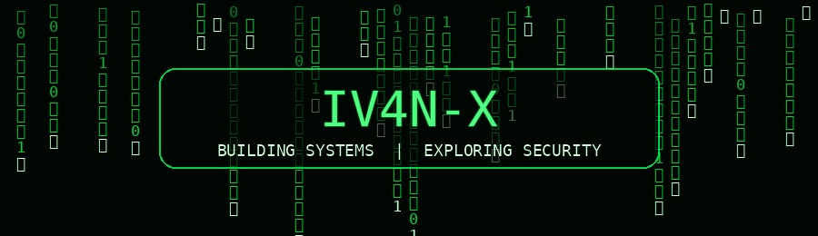

IV4N-X | Developer & Cybersecurity

  

  

  
  
  

⸻

👨‍💻 ABOUT ME

I’m a developer interested in programming, cybersecurity and Linux environments.

I enjoy creating practical tools, bots, automation scripts and experimenting with different technologies. I like understanding how systems work and improving my skills through personal projects.

* 🔭 Building: Automation tools, bots and personal projects.
* 🌱 Learning: Python, JavaScript and cybersecurity.
* 🐧 Exploring: Linux, BlackArch, Kali Linux and Termux.
* 🔌 Experimenting: ESP32 and embedded systems.
* 🎯 Goal: Become a cybersecurity specialist.

⸻

⚙️ TECH STACK

Programming Languages

  

Operating Systems & Tools

  

Hardware & Technologies

  

  
  
  

⸻

🚀 WHAT I’M WORKING ON

Project	Description
🤖 Automation Bots	WhatsApp and Telegram bots
🎵 MusicDrop	Music tools and automation
🐧 Linux Environment	Custom configurations and tools
🔌 ESP32 Projects	Embedded systems experiments

⸻

📂 FEATURED PROJECTS

  

<!-- Add your projects here later -->
<!--

-->

⸻

📊 GITHUB STATISTICS

  

💻 MOST USED LANGUAGES

  

🔥 CONTRIBUTION STREAK

  

📈 ACTIVITY GRAPH

  

⸻

🌐 CONNECT WITH ME

  
  

⸻

👁️ PROFILE VIEWS

  

⸻

  
  

  <i>Building systems. Exploring technology. Breaking limits.</i>

  

